<div align="center">

# ai-coding-setup

My Claude Code setup for taking a Linear issue to a merged pull request in a frontend + backend monorepo.

[Quick start](#install) · [How it works](#how-it-works) · [Skills](#skills) · [Agents](#agents) · [Configure](#configure) · [Profiles](#profiles)

</div>

<p align="center">
  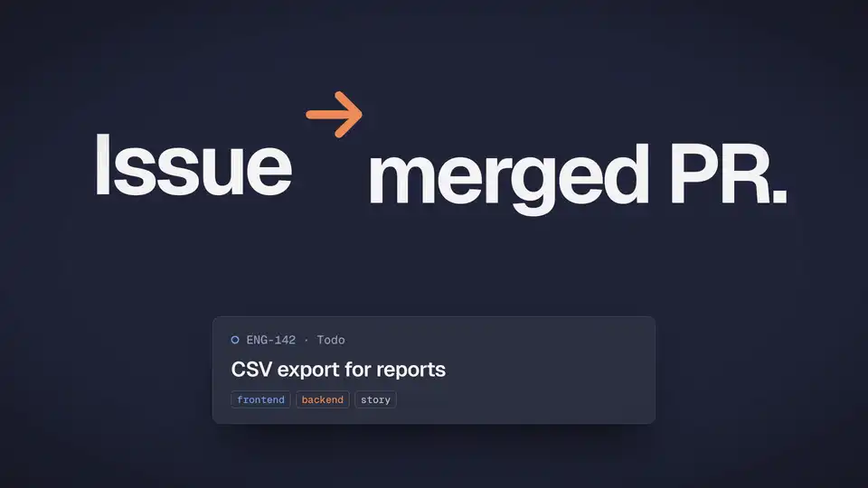
</p>

## What it does

It's a set of skills, subagents, hooks and shell helpers. I give it an issue, and `/kickoff` asks me
questions until the plan is clear, then writes tickets for both apps. `wt <branch> /work` opens a
separate worktree for the task, with its own ports and its own database, and agents build the tickets in
parallel. Every ticket is reviewed, and before it's committed I get a short explanation of what changed
and why, so I don't end up committing code I haven't read. `/pr` writes the pull request with screenshots
and asks before it pushes.

The things I cared about most:

- Several tasks can run at the same time without stepping on each other, because each one has its own
  worktree, ports and database.
- Nothing is pushed until I say yes.
- Agents have to show their work. A ticket comes back with every acceptance criterion marked `proven` or
  `not proven`, and a review finding can only block the merge if it's proven.
- If a repo already has its own skills (for PR descriptions, tests, planning), the workflow uses those
  instead of mine. `/wf-init` sets that up.

## How it works

<picture>
  <source media="(prefers-color-scheme: dark)" srcset="docs/diagrams/pipeline-dark.png">
  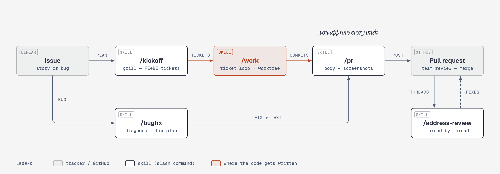
</picture>

### The ticket loop

`/kickoff` writes tickets with explicit blockers. `/work` starts every ticket whose blockers are done,
each with its own `wf-implementer` agent in its own worktree, and then lands them one at a time.

<p align="center">
<picture>
  <source media="(prefers-color-scheme: dark)" srcset="docs/diagrams/work-loop-dark.png">
  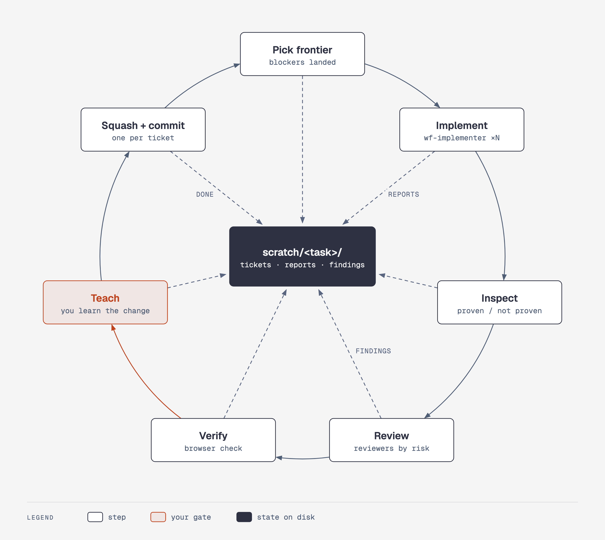
</picture>
</p>

### Reviews

`/deep-review` picks reviewers based on what the diff touches: one reviewer for a small change, up to four
specialists for a bigger one. A separate pass then tries to disprove every finding against the actual
code, so the list you get at the end is short and each item holds up.

<picture>
  <source media="(prefers-color-scheme: dark)" srcset="docs/diagrams/deep-review-dark.png">
  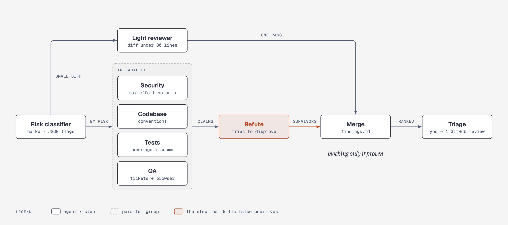
</picture>

### Three layers

Nothing in the core knows about your project. Project knowledge lives in two small files per repo: a
profile that says which of the repo's own skills handle which step, and a list of conventions your linter
can't check.

<picture>
  <source media="(prefers-color-scheme: dark)" srcset="docs/diagrams/layers-dark.png">
  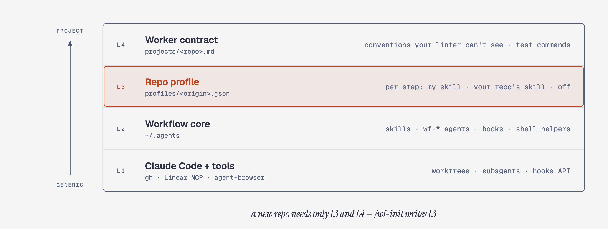
</picture>

## Commands

```
/kickoff <issue>     plan: context.md → grilling → tickets (FE + BE in one run)
/work [<ticket.md>]  the task's ticket loop (FE + BE, one frontier): parallel implementers in their own worktrees,
                     then review → teach → squash-merge → commit, one ticket at a time; a ticket file = that ticket only
/bugfix <issue>      quick path for obvious bugs, full root-cause path otherwise
/deep-review         review sized by a risk classifier; parallel specialists + a refute phase
/pr                  PR body in the repo's own `pr` skill sections, with screenshots
/deslop              simplify the branch's changes before /pr (optional)
/address-review      unresolved PR threads, one by one
/commit              one clean commit, terse message
/wf-init             map a repo's own skills onto the workflow's steps (a per-repo profile)
```

It's built around a monorepo with a frontend and a backend app, Linear for issues, GitHub for pull requests
and [agent-browser](https://github.com/vercel-labs/agent-browser) for checking the UI. Paths, ports, dev
commands, the database and tracker labels are all configuration (see [Configure](#configure)), and which
steps your repo's own skills take over is its [profile](#profiles). `WORKFLOW.md` is a one-page tour.

Separate frontend and backend repos aren't supported any more. Release **v3.7.1** is the last one that
handled that setup.

## Skills

Nine slash commands. In the diagrams, **YOU** marks the points where a skill stops and waits for you, and
**AGENT** marks a step a subagent does in its own context.

### `/kickoff <issue>`

Plans the work before anyone writes code. It reads the Linear issue (and the parent story, if there is
one), looks through the code for something similar that already exists, writes `context.md`, and then
asks you questions until nothing in the plan is open. Risky changes also get a rollback plan and a
premortem. It ends with FE and BE tickets, each listing the files it touches, how to check it, and the one
rule that's easiest to miss, plus the command that starts the work: `wt <branch> /work`.

<picture>
  <source media="(prefers-color-scheme: dark)" srcset="docs/diagrams/skill-kickoff-dark.png">
  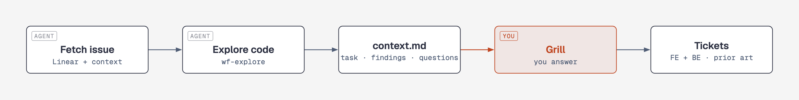
</picture>

### `/work`

Builds the tickets. Every ticket whose blockers are done goes to its own `wf-implementer` in its own
worktree, all at the same time. They come back one by one: the evidence gets checked, the change is
reviewed (and opened in a browser if it touches the UI), you get a short teach round so you know what
you're about to commit, and then it's squash-merged. When a blocker lands, the tickets waiting on it start.

<p align="center">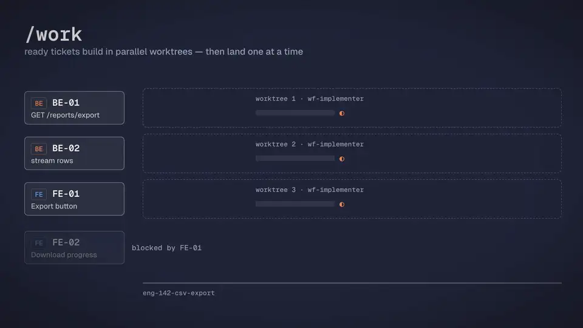</p>

### `/bugfix <issue>`

Small, obvious bugs take a quick path, and everything else gets a proper investigation. Either way you see
the diagnosis before any code changes, including the most likely other explanation and the check that
tells the two apart. UI bugs get screenshots from before and after the fix.

<picture>
  <source media="(prefers-color-scheme: dark)" srcset="docs/diagrams/skill-bugfix-dark.png">
  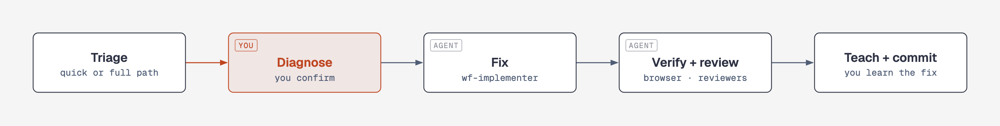
</picture>

### `/deep-review [pr]`

A small model reads the diff and decides who should review it: one reviewer for a small diff, up to four
specialists in parallel for a bigger one. Then every finding is checked against the code by an agent whose
only job is to prove it wrong. What's left is ranked, you go through it together, and it's posted as one
GitHub review. Only a proven finding blocks.

<p align="center">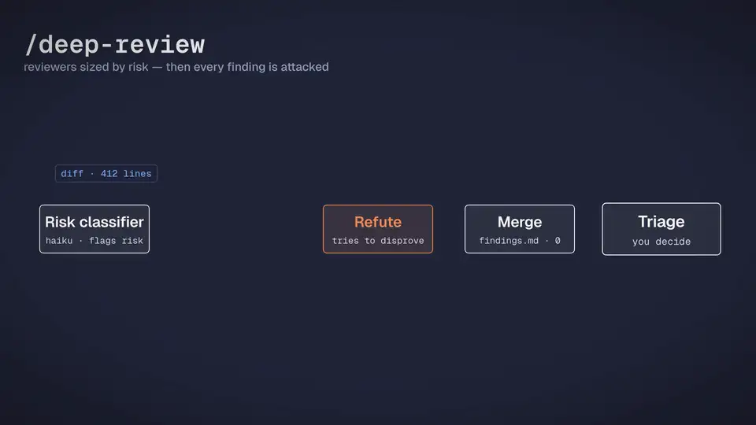</p>

### `/pr`

Writes the description in your repo's own PR format, using the branch, the tickets and the commits. It
takes AFTER screenshots of the screens it changed (and BEFORE screenshots plus a visual diff if you've set
up a baseline), asks before pushing, opens the PR and posts a short summary of the change.

<p align="center">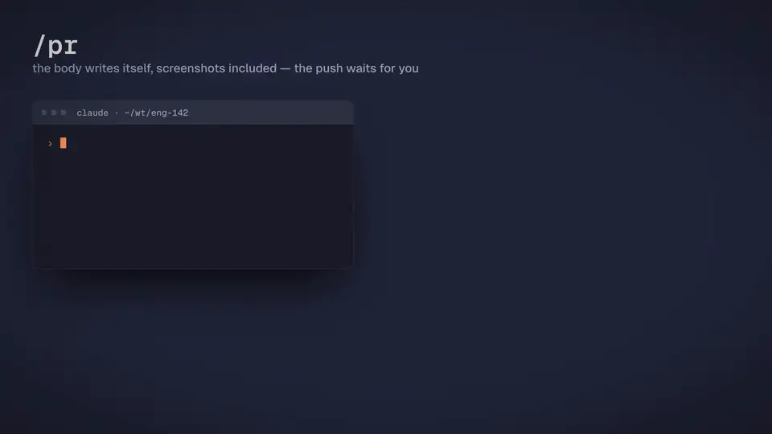</p>

### `/deslop`

Optional, before `/pr`. It goes through the branch's own changes looking for code that only looks
careful: one-line helpers, options nobody asked for, checks for things that can't happen. Anything worth
discussing is asked about one at a time.

<picture>
  <source media="(prefers-color-scheme: dark)" srcset="docs/diagrams/skill-deslop-dark.png">
  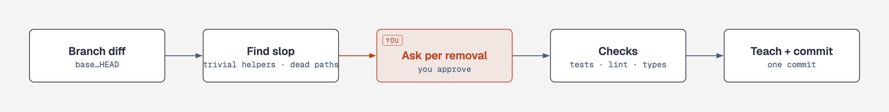
</picture>

### `/address-review [pr]`

Collects the unresolved review threads and works through them one at a time. Every reply starts by saying
whether it agrees, and before disagreeing it sums up the reviewer's best argument in one sentence. Threads
that reach outside the PR (secrets, CI, permissions) are flagged to you and never changed quietly.

<picture>
  <source media="(prefers-color-scheme: dark)" srcset="docs/diagrams/skill-address-review-dark.png">
  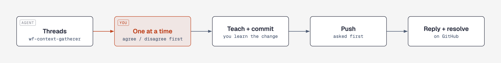
</picture>

### `/commit`

Stages files by name (never `git add -A`), gets a short two-to-four-line message from a small model,
checks it, and commits. It only amends commits that haven't been pushed, and it tells you when it does.

<picture>
  <source media="(prefers-color-scheme: dark)" srcset="docs/diagrams/skill-commit-dark.png">
  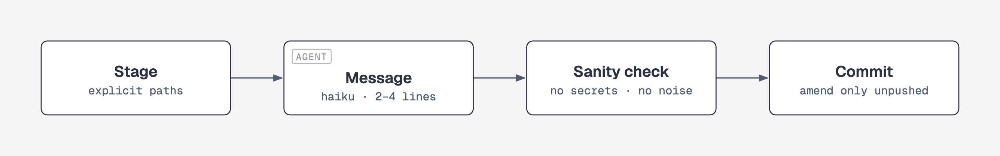
</picture>

### `/wf-init`

Looks at your repo's own skills, agents and conventions, suggests which of them should handle each step of
the workflow, asks you, and writes the [profile](#profiles). Then it does a dry run of `/work` and `/pr`
with it. Running it again later only shows what has changed.

<picture>
  <source media="(prefers-color-scheme: dark)" srcset="docs/diagrams/skill-wf-init-dark.png">
  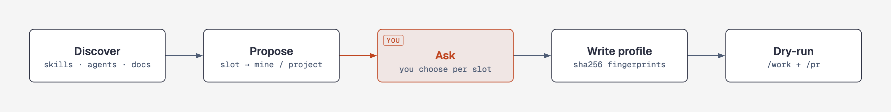
</picture>

## Agents

Skills coordinate, and agents do one focused job in a fresh context and report back briefly. Their names
start with `wf-` so they don't clash with agents your repo defines. Each agent has a fixed model: Opus for
reviews, where judgement matters, Sonnet for building and searching, and Haiku for small mechanical jobs.

<picture>
  <source media="(prefers-color-scheme: dark)" srcset="docs/diagrams/agents-dark.png">
  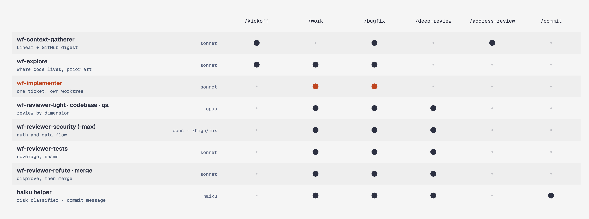
</picture>

## Layout

| Path | What |
|---|---|
| `skills/` | the slash commands above (`SKILL.md` each; `deep-review/prompts/` are the reviewer prompts) |
| `skills/_shared/` | text several skills read: `TEACH.md` (the teach round), `IDENTITY.md` (slug, side, base) |
| `agents/` | subagents, namespaced so a repo's own `.claude/agents/` never shadows them: `wf-implementer`, `wf-explore`, `wf-context-gatherer`, `wf-reviewer-*` |
| `hooks/` | `worktree-create.sh` (per-task worktrees, ports, per-worktree DB via `lib/db.sh`), `bash-guard.sh` (agents never start/kill dev servers or run watch-mode tests), `rtk-guard.sh`, `pr-created.sh`; `lib/config.sh` = every setting with its default |
| `shell/worktrees.zsh` | `wt`, `wts`, `wtwho`, `wtrm`, `wtclean`, `wtdb`, `ablogin`, `friction` |
| `bin/` | `wtconf` (prints the effective config; `--ports` a worktree's ports), `wfprofile` (reads a repo's profile), `pr-diagram-check`, `settings-sync`, `quiet` (pass/fail commands: one `ok:` line or the last 40 lines), `abcheck` (one browser check, a compact PASS/FAIL summary), `tickets` (one line per ticket) |
| `config.example.zsh` | template for your `config.local.zsh` |

## Requirements

- Claude Code (recent), macOS (BSD `sed -i ''`)
- `jq`, `perl`, `git`, `zsh`; `gh` ≥ 2.99 (`--attach`) for `/pr`
- Linear MCP server (`linear`) for `/kickoff`, `/bugfix` and story mode
- [agent-browser](https://github.com/vercel-labs/agent-browser) CLI for UI verification and screenshots
- optional: Docker with the backend's Postgres for per-worktree databases
- optional: [rtk](https://github.com/rtk-ai/rtk) (only `hooks/rtk-guard.sh` uses it; drop that hook if you don't use rtk)
- optional: `python3` with `playwright` for `/pr` diagrams

## Install

Skills and hooks refer to `~/.agents/…`, so clone the repo there (or let `install.sh` link `~/.agents` to your clone):

```sh
git clone <URL of this repo> ~/.agents
~/.agents/install.sh            # links skills/* and agents/*.md into ~/.claude; safe to re-run
~/.agents/install.sh --dry-run  # show what it would do
```

### settings.json

Merge into `~/.claude/settings.json`:

```json
{
  "permissions": { "allow": ["Bash(~/.agents/bin/wtconf:*)", "Bash(~/.agents/bin/quiet:*)", "Bash(~/.agents/bin/abcheck:*)", "Bash(~/.agents/bin/tickets:*)"] },
  "hooks": {
    "PreToolUse": [
      { "matcher": "Bash", "hooks": [
        { "type": "command", "command": "$HOME/.agents/hooks/rtk-guard.sh" },
        { "type": "command", "command": "$HOME/.agents/hooks/bash-guard.sh" } ] }
    ],
    "PostToolUse": [
      { "matcher": "Bash", "hooks": [ { "type": "command", "command": "$HOME/.agents/hooks/pr-created.sh" } ] }
    ],
    "WorktreeCreate": [
      { "hooks": [ { "type": "command", "command": "$HOME/.agents/hooks/worktree-create.sh" } ] }
    ]
  }
}
```

`bin/settings-sync` merges a repo-kept settings file (`~/.agents/settings.v3.1.json`, not included,
so create your own) with the live one; a key set to `null` there is deleted. Skip it if you edit
`~/.claude/settings.json` directly.

## Configure

```sh
cp ~/.agents/config.example.zsh ~/.agents/config.local.zsh   # then edit
echo 'source ~/.agents/shell/worktrees.zsh' >> ~/.zshrc
~/.agents/bin/wtconf                                         # check what the hooks and skills will see
```

`config.local.zsh` holds your real values: repo paths, the deployed API and base-branch FE, the
remote-API port, dev and setup commands, the patterns `bash-guard` uses to spot server starts and
watch-mode tests, the per-worktree database (container, prefix and migrate command, or off), what your
SSO login screen looks like, tracker labels and statuses. Every key and
its default is documented in `config.example.zsh` and `hooks/lib/config.sh`. The hooks and the shell
helpers read the file directly; skills read it through `wtconf`. Don't commit it to a
public repo; the leak guard refuses a `config.local.zsh`.

Per-project knowledge that isn't a single value (test commands, conventions the implementer follows and
the codebase reviewer enforces (what your linter can't see, one line each), which directories count as modules for `/pr` diagrams) goes in a worker contract,
`~/.agents/projects/<repo>.md` (<repo> = the monorepo's directory name; one Conventions section per app),
pulled into each worktree through the repo's `CLAUDE.local.md` (`@~/.agents/projects/<repo>.md`; the
worktree hook copies it and keeps it out of git via `.git/info/exclude`). Write your own; none are published.

## Profiles

A profile, `~/.agents/profiles/<id>.json` (id = the repo's origin URL, so every clone and worktree finds it),
says per step ("slot") whose text runs it: `plan.grill`, `plan.tickets`, `build.implement`, `build.tdd`,
`review`, `pr.body`, `pr.create`, `notify.summary`, `conventions`, `env`. Each slot is `mine`, `none`,
`project:<path>` (a skill in the repo) or `mine+project:<path>`, with `overrides` (plain text the workflow
states to the project skill, e.g. "seams are pre-agreed in the ticket, don't ask" or "commit only as `wip:`"),
and a sha256 fingerprint of every project file it relies on, read from one git ref (e.g. the default
branch). `env` holds the repo's config values. Run `/wf-init` in a repo to write one: it discovers the repo's
skills, agents and conventions, flags project skills that would break the workflow's gates (asking a user
from a background worker, pushing, committing without the teach round), asks per slot, writes the profile and
dry-runs `/work` and `/pr` against it. No profile → every slot is the workflow's own, with a one-line hint. A
fingerprinted file that changed or vanished stops the next run with the file named; re-running `/wf-init`
then shows only that difference.

## Third-party pieces (install them yourself)

The workflow calls these but does not ship them:

- **Matt Pocock's skills** — `/kickoff` loads `grilling`, `domain-modeling` and `to-tickets` from
  [mattpocock/skills](https://github.com/mattpocock/skills) v1.3.1:

  ```sh
  npx skills@1.7.0 add https://github.com/mattpocock/skills/tree/v1.3.1 -g -s grilling -s domain-modeling -s to-tickets -a claude-code
  ```

  then move them into `~/.agents/skills/` and link them into `~/.claude/skills/` (re-run `./install.sh`).
  `/kickoff` asks `to-tickets` for extra ticket fields (Repo, Touches, Verify by, Prior art) as a caller requirement.
- **diagram-design** — optional diagrams in `/pr` ([cathrynlavery/diagram-design](https://github.com/cathrynlavery/diagram-design)).
  In Claude Code: `/plugin marketplace add cathrynlavery/diagram-design`, then
  `/plugin install diagram-design@diagram-design`; PNG export needs `pip install playwright && playwright install chromium`.
  `bin/pr-diagram-check` tells `/pr` whether it is available; without it `/pr` simply skips the diagram.
- Your repo's own skills (optional) — mapped per step by `/wf-init`; without a profile the workflow uses its own.

## Leak guard

The repo is generated from a private one. `.githooks/pre-commit` (enable with
`git config core.hooksPath .githooks`) and the `leak-guard` GitHub Actions workflow scan for home
paths, emails, tokens and a committed `config.local.zsh` (`scripts/public-denylist.txt`) and run
gitleaks. Keep secrets in your environment, never in this repo.

## Credits

- `/deslop` and a few rules (issue-cause skepticism, agree-first replies, read-in-full, the dependency rule, the teach brief format) are adapted from [earendil-works/pi](https://github.com/earendil-works/pi) (MIT, © 2025 Mario Zechner).
- Evidence-bound work and reviews — the Easy-to-miss ticket line, proven / not proven acceptance marks, proven / plausible / unverified review findings, the repair cap, the no-archaeology and causes-with-evidence rules, the cold-reader rule — are adapted from [overment/limen](https://github.com/overment/limen) (MIT, © 2026 Adam Gospodarczyk).

## License

See [LICENSE](LICENSE).
